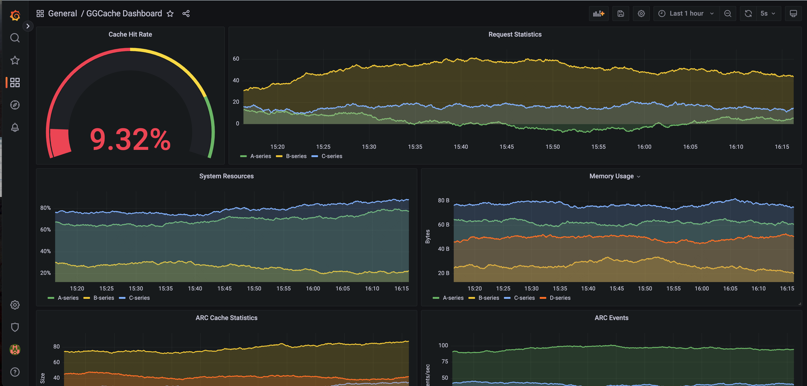

# gRPC Group Cache (ggcache)

## Project Introduction

A distributed cache system supporting:

- HTTP and gRPC protocols
- High-availability service registration and discovery
- Multiple cache eviction algorithms
- Dynamic node management
- Rapid network topology convergence
- Concurrent access control
- Real-time monitoring dashboard

## Feature Introduction

- **v1 version**, implemented:
    - Concurrent access control (`singleFlight`)
    - Load balancing (`consistenthash` algorithm)
    - Multiple cache eviction strategies (LRU, LFU, FIFO via Strategy pattern)
    - Communication between distributed cache nodes based on HTTP protocol
    - Communication between distributed cache nodes based on gRPC protocol
    - Simple service registration and discovery (requires manual import)
    - High-availability etcd cluster (configured using `goreman`)
    - Simple test cases

- **v2 version**, implemented:
    - Improved `singleFlight` with result caching logic to enhance performance
    - Added TTL mechanism (via a separate goroutine) for automatic cleanup of expired cache
    - Implemented simple business logic to test interaction between database and cache (two test cases)
    - Improved service registration and discovery using an `endpoint manager` for node management
    - Provided automated test scripts and environment setup guide

- **v3 version**, implemented:
    - Final version of service registration and discovery (using `endpoint manager` and `watch channel` to implement service pub/sub capabilities)
    - Used an event callback mechanism to update node status based on PUT and DEL events
    - Achieved second-level rapid convergence of network topology between nodes (dynamic node management)
    - Added gRPC client test retry logic
    - Failover mechanism: requests are forwarded to other nodes when a node fails; service continues as long as one node is restarted (requires cache re-warming)
    - After different nodes complete warming, RPC call latency between nodes is only 1ms (however, if querying non-existent data, latency can reach 999ms)
    - Node crashes or downtime do not broadly affect other warmed nodes (only a small range in the clockwise direction of virtual nodes is affected), and the node can provide service immediately upon recovery
    - Added defense strategy against cache penetration (storing null values for non-existent keys with a reasonable expiration time to prevent concurrent requests for non-existent keys from hitting the database)

- **v4 version**, implemented:
    - Overall code refactoring
    - Cache sharding to reduce lock granularity and improve concurrency performance
    - Added real-time monitoring with metrics collection (Prometheus, Grafana), deployable locally or in containers
    - Added advanced cache eviction algorithm `arc`
    - Optimized testing and CI/CD

> Rob Pike: "Don't communicate by sharing memory, share memory by communicating."

> This quote established the mainstream style of concurrency design in Go applications: using channels for communication between different goroutines. In the implementation of dynamic node management, channels are used for communication between the goroutine responsible for rebuilding the hash ring view (g1) and the goroutine responsible for listening to endpoint event changes (g2). Once the system adds or removes a node, g2 detects the change event and notifies g1 via a shared signal channel. Upon notification, g1 locks and rebuilds the hash ring view, thereby achieving concurrency-safe dynamic node management.

## Project Structure
```
.
├── README.md
├── api
│   ├── ggcachepb        // grpc server idl.
│   ├── studentpb           // business idl.
│   └── website             
├── cmd
│   ├── grpc
│   │   └── main.go         // grpc server latest version implement
│   └── http                // http server implement
├── config                  // global config manage
│   ├── config.go
│   └── config.yml
├── go.mod
├── go.sum
├── internal                
│   ├── middleware 
│   │   └── etcd            
│   │       ├── cluster       // goerman etcd cluster manage
│   │       ├── discovery     // service registration discovery (latest version use discovery3 impl.) 
│   ├── pkg
│   │   ├── student           // business logic
│   │   │   ├── dao
│   │   │   ├── ecode
│   │   │   ├── model
│   │   │   └── service
│   │   └── website          
│   └── service              // grpc group cache service imp.
│       ├── byteview.go      // read-only 
│       ├── cache.go         // concurrency-safe caching imp.
│       ├── cachepurge       // cache eviction algorithm implemented in strategy mode
│       │   ├── fifo         
│       │   ├── interfaces   // cache eviction algorithm interface abstract
│       │   ├── lfu
│       │   ├── lru
│       │   └── purge.go     // export distributed kv object
│       ├── consistenthash   // consistent hash algorithm for load balance
│       ├── group.go         
│       ├── groupcache.go    // group cache imp.
│       ├── grpc_fetcher.go  // grpc proxy 
│       ├── grpc_picker.go   // grpc peer selector
│       ├── http_fetcher.go  // http proxy
│       ├── http_helper.go   // http api server and http server start helper
│       ├── http_picker.go   // http peer selector
│       ├── interface.go     // grpc peer selector and grpc proxy abstract
│       └── singleflight     // single flight concurrent access control
├── main.go                  // grpc server default imp. equal to cmd/grpc/main.go
├── script                   // grpc and http service test
│   ├── test
│   │   ├── grpc
│   │   └── http
│   ├── test.md              // test step
│   ├── test0.sh
│   ├── test1.sh
│   ├── test2.sh
│   └── test3.sh
└── utils
    ├── logger
    ├── shutdown            // goroutine gracefully_shutdown
    ├── trace
    └── validate            // ip address validation
```

## Dependencies

1. etcd service (`"127.0.0.1:2379"`)
2. mysql service (`"127.0.0.1:3306"`)
3. goreman (etcd cluster) - Instructions available in `internal/middleware/etcd/cluster`
    - This project depends on an etcd cluster by default. You need to stop your local etcd service first, then use goreman to start three etcd services for unified management.
    - If you do not want to depend on an etcd cluster, delete 22379 and 32379 in `config/config.yml` and start your local etcd service.
5. gorm (Database)
6. grpc (RPC communication protocol)
7. logrus (Log management)
8. viper (Configuration management)
9. protobuf (Serialization)

## System Operation

### Warming Phase
https://github.com/1055373165/ggcache/assets/33158355/3215adb2-6615-481f-861d-6c1369179d7c

1. Start the etcd cluster (3 nodes) using goreman to implement a high-availability, strongly consistent external storage center.
2. Start multiple gRPC service nodes; node information changes can be captured in seconds for rapid convergence.
3. Start multiple gRPC clients and continuously send query requests to the gRPC service cluster (intentionally including non-existent keys).
4. When each node first starts, it has no cached data and must query the backend database, effectively warming up the cache.

### Working Phase

https://github.com/1055373165/ggcache/assets/33158355/7b95a2c2-98a5-40bd-8467-b19c55a3292e

1. Once certain nodes complete warming, results are returned directly from the cache, and processing speed increases visibly.
2. Send a termination signal to two service nodes; normally working nodes remain unaffected, and restarted nodes continue providing service upon joining (the network topology is rebuilt automatically in the background).
3. If all nodes are shut down, the client retry mechanism takes effect with a maximum of 3 retries (configurable), backing off by 1s, 2s, and 4s. During retries, if any one node completes a restart, it can immediately return results.
4. After a node restarts, it returns to its previous normal state. The key-assignment relationship between nodes does not change (virtual nodes on the hash ring are fixed), so it does not lead to massive cache invalidation.

### Dynamic Node Management

https://github.com/1055373165/ggcache/assets/33158355/1c771e10-c11c-493f-8488-a1cfa7e45f1e

The dynamic acquisition speed can be custom-configured. Since network topology is generally stable, there is no need for a background long-polling task to constantly monitor unlikely events, as that would be a waste of system performance.

### Real-time Monitoring Dashboard



## Optimization Directions (Todo)

1. Automatically detect service node changes and dynamically add/remove nodes (crucial for request distribution when nodes change) ✅
    - Implementation Idea 1: Listen for server start/stop signals using `endpoint manager` ✅
    - Implementation Idea 2: Use etcd's official `WatchChan()` service pub/sub mechanism ✅
2. Add cache hit rate metrics (for dynamic adjustment of cache capacity) todo
3. Optimize load balancing strategy ✅
    - Add `arc` algorithm ✅
    - Upgrade `LRU2` algorithm (high/low watermarks) todo
4. Add request rate limiting (Token Bucket algorithm) todo
5. Add special handling for non-existent keys ✅
6. Add request retry and backoff mechanism ✅
7. Add concurrency-safe dynamic node view rebuilding capability ✅
8. Implement consistency between cache and database (add message queue for asynchronous processing) (could also be implemented via cache eviction callbacks) todo (High priority)
9. Add metrics collection and real-time monitoring ✅
10. Add one-click deployment script ✅

...

## Reference Resources
1. [Geektutu Distributed Cache `GeeCache`](https://geektutu.com/post/geecache.html) 
2. [gcache cache eviction strategies](https://github.com/bluele/gcache)
3. [groupcache Swiss Army Knife](https://github.com/golang/groupcache) 
4. [`gRPC` Official Documentation](https://grpc.io/docs/languages/go/quickstart/)
5. [`protobuf` Official Documentation](https://protobuf.dev/programming-guides/proto3/) 
6. [`protobuf` Encoding Principles](https://www.notion.so/blockchainsee/Protocol-Buffer-04cba19af055479299507f04d0a24862) 
7. [`protobuf` Personal Learning Notes](https://www.notion.so/blockchainsee/protoscope-fbfe36c2eef64bfcb630be4f0bd673f5) 
8. [etcd Official Documentation](https://etcd.io/docs/v3.5/) 
9. [`etcd` Cluster Setup](https://github.com/mattn/goreman)
10. [shell scripts](https://www.shellscript.sh/) 
11. [golang database framework](https://gorm.io/docs/models.html) 
12. [air dynamic loading](https://github.com/cosmtrek/air) 
13. [Minimalist and colorful `Go` log library](https://github.com/charmbracelet/log)
